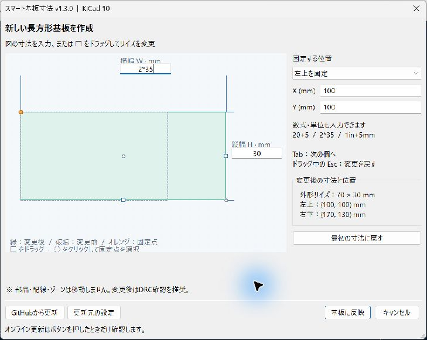

# KiCad 10 スマート基板寸法（日本語版）※現在調整中更新をお待ちください

## 開発中：PCB上の数字から編集するネイティブ版

外部プラグインを毎回起動せず、標準の寸法の数字から数値・計算式を入力できるように、KiCad 10.0.7本体のC++パッチを開発しています。標準寸法ツールの角への吸着を使い、長方形外形の幅・高さを変更する構成です。

**WindowsでC++ビルド・PCBエディタ起動・C++テスト16件が成功しました。画面上のクリック編集・スナップ・Undo/Redoは検証中です。** Source Preview 1はソースパッチの配布で、コンパイル済みアプリは含みません。実装、対応範囲、ビルド手順と検証状況は [ネイティブ版README](https://github.com/conmmitmentman/KiCad-SmartBoardDimension/blob/main/native/README.md) を参照してください。

以下は既存のPythonプラグイン版です。Python版のWindowsインストーラーでは、上記のネイティブ機能は導入されません。

## Pythonプラグイン版

**KiCad 10.x の PCB エディタで、`Edge.Cuts` の長方形基板外形を幅・高さ（mm）で編集する日本語 Action Plugin。**

> Windows / KiCad **10.0.7** で確認した修正版です。単体・モックテスト25件、実際の `pcbnew` / `wx` を用いた検証6件が成功しています。確認範囲と未確認事項は [実機検証記録](docs/VALIDATION_JA.md) を参照してください。重要な設計では `.kicad_pcb` をバックアップしてください。KiCad公式プラグインではありません。

**バージョン：1.3.0**（PCB上の寸法入力・固定点選択・詳細編集）

プラグインを起動するとPCB上に幅・高さの寸法を配置します。数字をクリックして数値・計算式を入力できます。PCBを開くたびにプラグインの起動が必要です。「詳細・更新」から開く補助画面では、外形図のW/Hを直接クリックして入力できます。辺の□をドラッグすると0.1 mm刻みでサイズを変更し、○をクリックすると固定点を選択します。緑が変更後、破線が変更前、オレンジが固定点です。「基板に反映」で確定します。幅・高さは0.01〜2000 mm、基準点と変更後の四隅は±2000 mmに制限し、KiCadの座標オーバーフローを防止します。

## 何ができる？

| 機能 | 内容 |
|---|---|
| 長方形基板の編集 | `Edge.Cuts` に描かれた単独の長方形、または閉じた4本の直線に対応 |
| 幅・高さを数値指定 | 幅 W / 高さ H を mm 単位で指定 |
| 基準点を選択 | 左上固定・中心固定・右下固定 |
| 基準点座標 | X / Y を mm 単位で入力 |
| 数式と単位 | `20+5`, `2*15`, `1in+5mm`, `100mil` など |
| 外形の新規作成 | `Edge.Cuts` に外形がなければ長方形を作成 |
| 図と数値のライブプレビュー | 変更前後の外形を同じ縮尺で重ね、寸法と座標を表示 |
| 直接操作 | 図上のW/H入力、辺のドラッグ、固定点のクリック、編集内容のリセット |
| **GitHubから更新** | PCBエディタ内の「GitHubから更新」で公開済み最新版を取得・検証・適用（既定の更新先を設定済み） |
| オフライン更新 | ZIPを展開し `Windows_更新.bat` でプラグインの5ファイルを更新 |
| 復元 | 更新前に自動退避したファイルを `Windows_前の版に戻す.bat` で復元 |

### 詳細編集の補助画面



PCB上の編集バーで「詳細・更新」を開いた場合の操作です。

1. 上のW欄・右のH欄に寸法を入力。`2*40` のような数式も使えます。
2. 固定したい○をクリック（左上・中心・右下）。選択時は現在の形状を維持します。
3. □をドラッグして調整、または数値で正確に指定します。
4. 「基板に反映」で確定。「キャンセル」なら基板を変更せず閉じます。

操作設計は [SolidCraftのスケッチ寸法入力](https://github.com/tangency-labs/solidcraft/blob/4f4b1fc2d2ab2e46e9a87b52c31411120cc1ed99/docs/book/src/guide/sketching.md) の、形状のそばで数式を入力して寸法を決める操作を参考にしています。本ツールは独自のPython/wx実装で、長方形の基板外形を対象とします。SolidCraftの拘束ソルバーや名前付きパラメーターは搭載しません。

## インストール（Windows 10 / 11）

1. [最新版Release](https://github.com/conmmitmentman/KiCad-SmartBoardDimension/releases/latest) から `KiCad10_SmartBoardDimension_v1.3.0_Windows.zip` を取得します。
2. **ZIP 全体を展開**します（ZIP 内から `.bat` を直接起動しないでください）。
3. KiCad の PCB エディタを終了します。
4. `Windows_インストール.bat` をダブルクリックします。管理者権限は通常不要です。
5. 完了後、KiCad 10 の PCB エディタを起動します。
6. **ツール → 外部プラグイン → スマート基板寸法（幅・高さ）** から使用します。

通常のインストール先（ドキュメントフォルダの移動設定にも対応）：

```text
[Windows の「ドキュメント」フォルダ]\KiCad\10.0\scripting\plugins\
└── smart_board_dimension\
    ├── __init__.py
    ├── geometry.py
    ├── canvas.py
    ├── direct_editor.py
    └── updater.py
```

Windows の再起動や KiCad の再起動ごとに再インストールする必要はありません。手動導入や Linux / macOS については [インストールガイド](docs/INSTALL_JA.md) を参照してください。

「ドキュメント」に書き込めない場合、v1.2.1のインストーラーは代替先 `%APPDATA%\kicad\10.0\scripting\plugins\smart_board_dimension` を使用します。画面の **「対象:」が実際の配置先**です。Windowsの保護設定を変更する必要はありません。既存の配置先が見つかった場合は同じ場所を更新します。

アンインストール時はPCBエディターを閉じ、実際の配置先の `smart_board_dimension` フォルダーだけを削除します。更新前のコードへ戻す場合は `Windows_前の版に戻す.bat` を使います。バックアップは `%LOCALAPPDATA%\SmartBoardDimension\backups` にあります。

## GitHubから更新（Ver.1.2.0以降）

**KiCad内の「GitHubから更新」ボタン**を押すと、GitHub Releases の最新正式版を確認します。更新が見つかれば確認ダイアログが表示され、そのまま自動でダウンロード・SHA256検証・バックアップ・ファイルの置換まで実行します。アップデート後は**PCBエディタの再起動が必要**です。

### 使い方

1. KiCad 10 のPCBエディタで **ツール → 外部プラグイン → スマート基板寸法（幅・高さ）** を起動します。
2. ダイアログ下部の **「GitHubから更新」** をクリックします。
3. 更新元は `conmmitmentman/KiCad-SmartBoardDimension` を設定済みです。変更する場合だけ「更新元の設定」を使います。
4. 新版が公開されていれば「更新しますか？」の確認で「はい」をクリックします。
5. 更新完了メッセージを確認し、編集中の基板を保存して**KiCadのPCBエディタを再起動**します。

リポジトリの情報はWindowsの `%LOCALAPPDATA%\SmartBoardDimension\settings.json` に保存されます。後から変える場合は **「更新元の設定」** を使用します。自動更新確認はせず、ユーザーがボタンをクリックしたときだけインターネット通信します。

**正式Releaseが未公開の場合は自動更新できません。** リポジトリ内にZIPを置くだけでは不十分です。「公開済みの正式Releaseまたは配布ファイルが見つかりません」と表示されても、基板寸法の編集は使用できます。新版のZIP・チェックサムを正式Releaseに添付するまで、オフライン更新を使用してください。

詳しい仕組み・公開側の設定・注意点：[ワンクリック更新ガイド](docs/ONLINE_UPDATE_JA.md)

## オフライン更新・旧版への復元

### ZIP経由の更新（例：v1.1.0 → v1.2.0）

1. 新版の ZIP をダウンロードして**全体を展開**します。
2. **PCB エディタを終了**します。
3. 新版に含まれる `Windows_更新.bat` を実行します。
4. 既存のPythonファイルが自動バックアップされ、その後新版の4ファイルに置き換わります。
5. PCB エディタを起動し、動作確認します。

不具合があれば **`Windows_前の版に戻す.bat`** を実行します（更新前のバックアップがある場合のみ）。オフライン方式はZIPを手動で入手して上書きする方法です。オンライン更新は上の「GitHubから更新」ボタンから実行できます。旧版v1.1.0以前には更新ボタンがないため、**今回のv1.3.0を手動で導入**してください。

詳細：[更新・復元ガイド](docs/UPDATE_JA.md)

## 使い方

1. 編集する基板の `.kicad_pcb` ファイルをバックアップします。
2. `Edge.Cuts` へ単独の軸平行長方形、または4本の閉じた軸平行線分で基板外形を作成します。外形がなければ新規作成できます。
3. ツール → 外部プラグインからプラグインを起動します。
4. W / H / 基準点 / X / Y を入力します。
5. 図と数値のプレビューを確認して「基板に反映」を押します。
6. **基板を保存し、DRC（設計ルールチェック）を実行**します。

例：40 × 30 mm の長方形を左上固定で 60 × 45 mm にする場合、`W=60`, `H=45`, `基準点=左上を固定` を指定します。部品・配線は動きません。

詳細：[操作ガイド](docs/USAGE_JA.md)

## 制限事項・安全上の注意

- **長方形専用**：角丸・円弧・切り欠き・斜め・複数外形・穴付き外形は非対応。予期しない `Edge.Cuts` 図形が存在する場合は変更を中止します。
- **対象は基板外形のみ**：フットプリント、配線、パッド、ゾーン、設計ルールは自動調整されません。基板を縮小すると部品等が外へ出る可能性があります。
- **Fusion風の完全な寸法拘束機能ではありません**：キャンバス上の寸法線をクリックして編集したり、他の図形を拘束連動させたりする機能は未実装です。
- **元に戻す（Undo）は保証されません**。実行前のファイルバックアップが必要です。
- **KiCad 10 向け**：旧SWIG `pcbnew.ActionPlugin` 方式を使用します。KiCad 11 ではSWIG APIの廃止が予定されています。将来は IPC API への移行が必要です。
- Windows用のオフライン更新バッチは**3個のPythonファイル**を配置し、ネットワーク通信はしません。
- **オンライン更新はGitHubの公開Releaseのみ**を利用し、SHA256・更新マニフェストの整合性を検証してからコードを更新します。電子署名・第三者監査はなく、更新元リポジトリの管理者を信頼する必要があります。

## 対応環境とテスト

- KiCad：10.0.7 / Windowsで検証。その他の10.x・OSでの実機検証は未実施
- OS：Windows 10 / 11 を主対象としたインストーラー。Linux / macOS は手動配置
- Python：KiCadに組み込まれた `pcbnew` / `wx` を使用。幾何ロジックのテストには標準ライブラリのみ使用
- テスト：`python -m unittest discover -s tests -v`
- 実API検証：KiCad付属Pythonで `python tools/check_kicad.py`（モックテストと別プロセスで実行）

トラブルシューティング：[よくある問題](docs/TROUBLESHOOTING_JA.md)

## ファイル構成

```text
.
├── smart_board_dimension/
│   ├── __init__.py               # KiCad Action Plugin / 日本語画面
│   ├── geometry.py               # 長さ演算・長方形判定
│   ├── canvas.py                 # 図上入力・ドラッグ・外形プレビュー
│   └── updater.py                # GitHub Releases更新・チェックサム検証・復元用バックアップ
├── scripts/installer.ps1         # インストール・更新・復元の処理
├── Windows_インストール.bat
├── Windows_更新.bat
├── Windows_前の版に戻す.bat
├── docs/                         # 日本語説明書（オンライン更新ガイドを含む）
├── tests/                        # KiCadを使わないテスト
├── tools/build_release.py        # Release ZIPを生成
├── update_manifest.json          # 配布ZIPのみに自動生成（ソース側には置かない）
├── CHANGELOG.md
├── CONTRIBUTING.md
├── SECURITY.md
└── LICENSE
```

## GitHubに公開する方へ

[GitHub公開手順](docs/GITHUB_PUBLICATION_JA.md) に、ソースのアップロードとReleaseの公開方法をまとめています。既定の更新先は [conmmitmentman/KiCad-SmartBoardDimension](https://github.com/conmmitmentman/KiCad-SmartBoardDimension) です。

## 開発・提案

- [開発・テスト手順](docs/DEVELOPMENT_JA.md)
- [オンライン更新の設定・仕様](docs/ONLINE_UPDATE_JA.md)
- [更新履歴](CHANGELOG.md)
- [今後の機能案](docs/ROADMAP_JA.md)
- [不具合報告・機能提案](CONTRIBUTING.md)
- [セキュリティについて](SECURITY.md)

## 公式資料

- [KiCad 10 PCB エディタマニュアル](https://docs.kicad.org/10.0/ja/pcbnew/pcbnew.html)
- [KiCad Python Action Plugin / SWIG の説明](https://dev-docs.kicad.org/en/apis-and-binding/pcbnew/)
- [KiCad 10 pcbnew Python API](https://docs.kicad.org/doxygen-python-10.0/namespacepcbnew.html)
- [KiCad IPC API（将来の移行先）](https://dev-docs.kicad.org/en/apis-and-binding/ipc-api/for-addon-developers/)
- [GitHub APIの最新リリース取得](https://docs.github.com/en/rest/releases/releases#get-the-latest-release)
- [GitHub APIのリリースアセット](https://docs.github.com/en/rest/releases/assets)

## ライセンス

[MIT License](LICENSE)。無保証。本プロジェクトは KiCad 開発チームとは独立した非公式ツールです。
